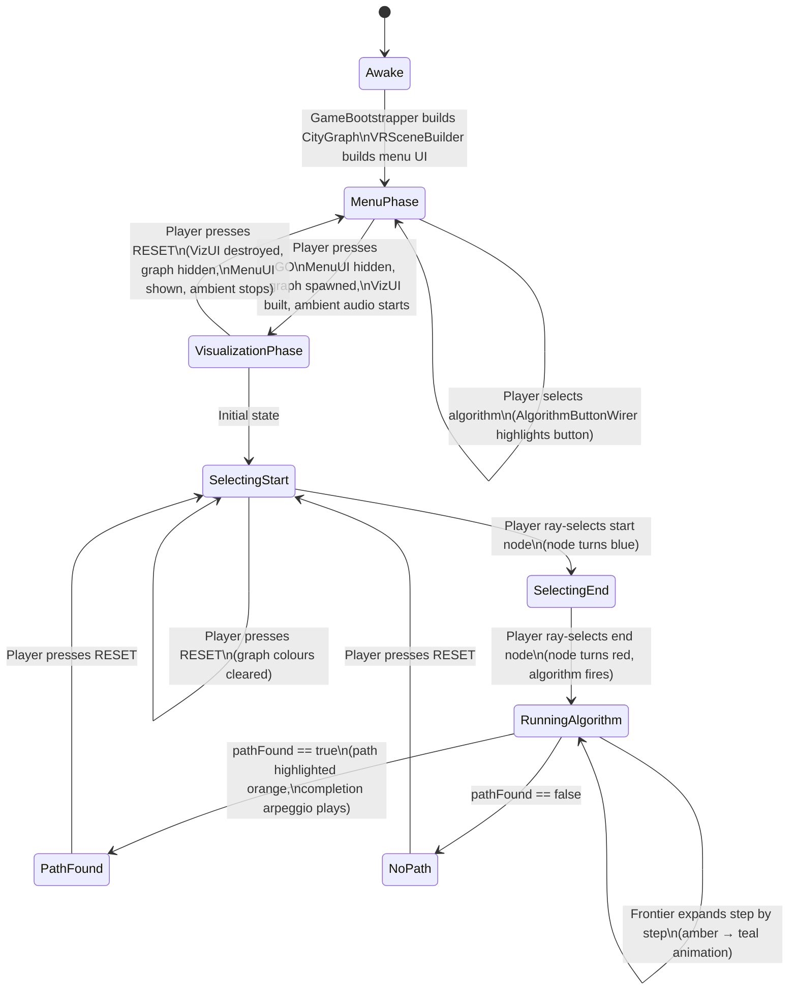
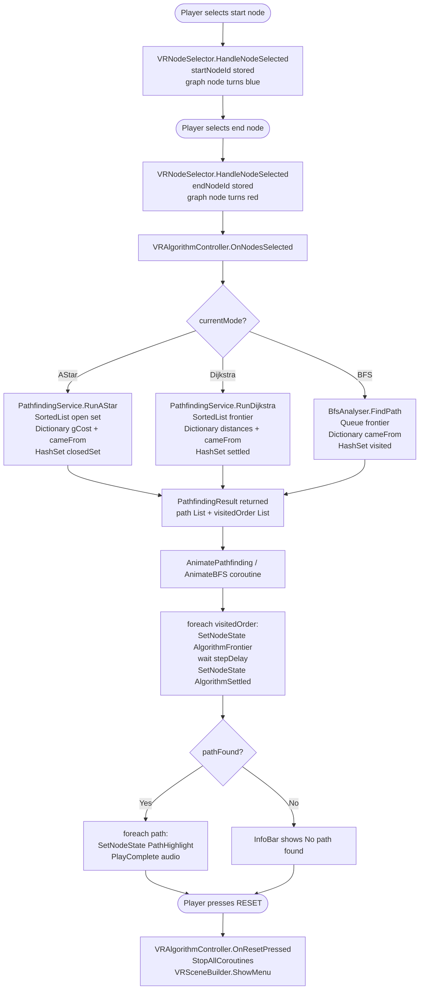
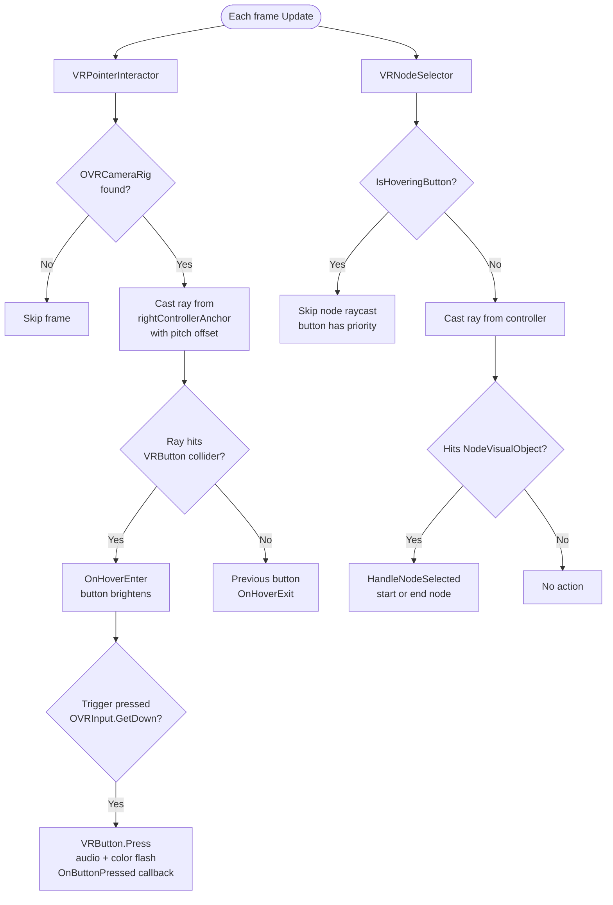

# AD_Crea – Emergency Response Routing
## ADCREA Semester Project Documentation – FS 2026

---

## 1. Project Overview

**Concept:** A VR demonstrator running on Meta Quest that simulates an emergency dispatch
system routing ambulances through a city road network. The player selects a start node
(dispatch station) and an end node (incident location), then watches three different
pathfinding algorithms search for the optimal route in real time.

**Why this data story:** Emergency routing is a canonical, high-stakes graph problem.
Speed of route calculation directly affects life-or-death outcomes, making the comparison
between BFS (fewest hops), Dijkstra (minimum travel time), and A* (heuristic-guided
minimum time) immediately meaningful to any observer.

**Platform:** Unity 6 (6000.0.56f1), Meta Quest 3, C# scripting only.

---

## 2. Data Structures Used

The project uses **six distinct data structures**, each chosen for a specific reason:

| # | Structure | Where used | Why chosen |
|---|-----------|-----------|------------|
| 1 | `Dictionary<int, List<GraphEdge>>` | `CityGraph.adjacencyList` | O(1) lookup by node ID; adjacency list representation is memory-efficient for sparse graphs |
| 2 | `Dictionary<int, GraphNode>` | `CityGraph.nodeData` | Decouples topology from metadata; traversal never loads positions unless needed |
| 3 | `List<int>` | `PathfindingResult.path`, `PathfindingResult.visitedOrder` | Ordered sequence required for both path reconstruction and step-by-step animation |
| 4 | `Queue<int>` | `BfsAnalyser.frontier` | FIFO guarantee ensures BFS processes nodes level-by-level, finding minimum hops first |
| 5 | `Stack<int>` | `PathfindingService.ReconstructPath`, `BfsAnalyser.ReconstructPath` | `cameFrom` produces path in reverse; push then pop naturally reverses it without array reversal |
| 6 | `SortedList<double, int>` | `PathfindingService` (Dijkstra and A* frontiers) | Index 0 always holds the minimum-cost node; O(log n) insert; `double` key avoids float precision freeze at high cost values |
| + | `HashSet<int>` | Dijkstra settled set, A* closed set, BFS visited set, edge deduplication | O(1) contains-check; prevents re-processing already-settled nodes |

---

## 3. Algorithms Used

### 3.1 Breadth First Search (BFS)
**File:** `BfsAnalyser.cs`
**Purpose:** Finds the path with the fewest road segments (hops) between two nodes.
**Why BFS here:** A FIFO `Queue` guarantees that the first time the destination is
dequeued, it was reached via the minimum number of edges. Edge weights are irrelevant —
two slow roads beat one fast highway. This makes BFS visually distinct from Dijkstra:
the search wave expands in concentric rings, ignoring the cost of each road.

### 3.2 Dijkstra's Algorithm
**File:** `PathfindingService.RunDijkstra`
**Purpose:** Finds the route with the minimum total travel time (edge weights in seconds).
**Why Dijkstra here:** Explores all nodes in order of cumulative cost from the start.
Guaranteed optimal but explores many unnecessary nodes — the amber frontier visibly
fills large portions of the grid before reaching the goal, demonstrating why a heuristic
helps.

### 3.3 A* Algorithm
**File:** `PathfindingService.RunAStar`
**Purpose:** Finds the minimum travel-time route using a geographic heuristic to focus the search.
**Why A* here:** Extends Dijkstra with `h(n) = Euclidean distance / max road speed`,
which estimates the minimum remaining travel time. Because `h(n)` never overestimates
(admissible), the result is still optimal. The directional bias means A* skips whole
quadrants that Dijkstra must settle, making the visual contrast between the two
algorithms the central teaching moment of the project.

**Heuristic calibration:** `maxRoadSpeedMetresPerSecond = 0.08` is derived from the
tightest edge ratio in the graph (`sqrt(2) / 18s ≈ 0.079`), so `h(n)` is always
slightly below true cost — admissible by construction.

---

## 4. Scene Object Hierarchy and Components

```
SampleScene
├── DirectionalLight
├── Global Volume
├── OVRCameraRig                          (Meta XR SDK prefab)
│   ├── OVRManager                        (XR runtime, OVRInput)
│   ├── TrackingSpace
│   │   ├── LeftHandAnchor
│   │   ├── RightHandAnchor               (controllerTransform source)
│   │   │   └── OVRHand (right)
│   │   └── CenterEyeAnchor
│   └── ...
├── PassThrough                           (Quest passthrough / mixed reality)
├── SystemRoot                            (all game logic lives here)
│   ├── GameBootstrapper                  (builds CityGraph in Awake)
│   ├── CityGraphFactory                  (constructs the 68-node graph)
│   ├── GraphVisualizer                   (spawns node spheres + edge lines)
│   ├── VRSceneBuilder                    (builds all UI at runtime)
│   ├── VRAlgorithmController             (drives algorithm selection + animation)
│   └── VRNodeSelector                    (ray-select start and end nodes)
│       [Added at runtime by VRSceneBuilder.Start():]
│       ├── AudioManager
│       └── VRPointerInteractor
└── GraphRoot                             (anchor for graph world position)
```

**Runtime-created UI (Phase 1 – Menu):**
```
MenuUI
├── PanelMenu (background cube)
├── Label_SELECT ALGORITHM
├── BtnAStar  + AlgorithmButtonWirer
├── BtnDijkstra + AlgorithmButtonWirer
├── BtnBFS    + AlgorithmButtonWirer
├── BtnGo     + GoButtonWirer
└── Label_hint
```

**Runtime-created UI (Phase 2 – Visualization):**
```
VizUI
├── BtnReset  + ResetButtonWirer
├── SpeedSliderTrack  (VRSlider lives on SystemRoot)
├── SpeedSliderHandle
├── PanelInfoBar + VRInfoBar
└── InfoText (TextMeshPro)
```

---

## 5. Class Diagram

```mermaid
classDiagram
    direction TB

    class GraphNode {
        +int nodeId
        +Vector2 position
        +string label
        +GraphNode(int, Vector2, string)
    }

    class GraphEdge {
        +int sourceNodeId
        +int targetNodeId
        +float weight
        +GraphEdge(int, int, float)
    }

    class CityGraph {
        -Dictionary~int,List~GraphEdge~~ adjacencyList
        -Dictionary~int,GraphNode~ nodeData
        +AddNode(GraphNode)
        +AddEdge(int, int, float)
        +GetEdgesFrom(int) List~GraphEdge~
        +GetNode(int) GraphNode
        +GetAllNodeIds() IEnumerable~int~
        +ContainsNode(int) bool
        +NodeCount int
    }

    class PathfindingResult {
        +List~int~ path
        +List~int~ visitedOrder
        +float totalCost
        +bool pathFound
    }

    class NodeVisualState {
        <<enumeration>>
        Default
        StartNode
        EndNode
        AlgorithmFrontier
        AlgorithmSettled
        PathHighlight
        BfsCoverage
    }

    class AlgorithmMode {
        <<enumeration>>
        AStar
        Dijkstra
        BFS
    }

    class PathfindingService {
        -float maxRoadSpeedMetresPerSecond
        +RunDijkstra(CityGraph, int, int) PathfindingResult
        +RunAStar(CityGraph, int, int) PathfindingResult
        -CalculateHeuristic(GraphNode, GraphNode) float
        -ReconstructPath(Dictionary, int, int) List~int~
    }

    class BfsAnalyser {
        +FindPath(CityGraph, int, int) PathfindingResult
        -ReconstructPath(CityGraph, Dictionary, int, int, PathfindingResult)
        -GetEdgeCost(CityGraph, int, int) float
    }

    class CityGraphFactory {
        <<MonoBehaviour>>
        +BuildGraph() CityGraph
        -NodeName(int, int) string
        -AddNode(CityGraph, int, Vector2, string)
        -AddEdge(CityGraph, int, int, float)
    }

    class NodeVisualObject {
        <<MonoBehaviour>>
        +int nodeId
        -Renderer nodeRenderer
        -float baseScale
        -AudioManager audioManager
        +Initialize(int)
        +SetState(NodeVisualState)
        -PulseScale() IEnumerator
    }

    class GraphVisualizer {
        <<MonoBehaviour>>
        -Dictionary~int,NodeVisualObject~ nodeVisuals
        -List~LineRenderer~ edgeRenderers
        -CityGraph graph
        +Initialize(CityGraph)
        +SetNodeState(int, NodeVisualState)
        +ResetAllNodes()
        +DestroyGraph()
        +GetNodeWorldPosition(int) Vector3
    }

    class GameBootstrapper {
        <<MonoBehaviour>>
        -CityGraph cityGraph
        -GraphVisualizer visualizer
        -CityGraphFactory factory
        +GetGraph() CityGraph
        +ShowGraph()
        +HideGraph()
    }

    class VRAlgorithmController {
        <<MonoBehaviour>>
        +float stepDelay
        +AlgorithmMode CurrentMode
        +bool IsRunning
        +string StatusMessage
        -PathfindingService pathfindingService
        -BfsAnalyser bfsAnalyser
        -CityGraph cityGraph
        +OnNodesSelected(int, int)
        +OnGoPressed()
        +OnResetPressed()
        +OnAStarSelected()
        +OnDijkstraSelected()
        +OnBFSSelected()
        -RunAlgorithm()
        -AnimatePathfinding(PathfindingResult) IEnumerator
        -AnimateBFS(PathfindingResult) IEnumerator
    }

    class VRSceneBuilder {
        <<MonoBehaviour>>
        -VRAlgorithmController algorithmController
        -GameBootstrapper bootstrapper
        -VRSlider speedSlider
        +ShowVisualization()
        +ShowMenu()
        -BuildMenuUI()
        -BuildVizUI()
        -BuildSpeedSlider()
    }

    class VRButton {
        <<MonoBehaviour>>
        +string buttonLabel
        +Action OnButtonPressed
        -Renderer buttonRenderer
        -AudioManager audioManager
        +OnHoverEnter()
        +OnHoverExit()
        +Press()
        +SetSelected(bool)
    }

    class VRPointerInteractor {
        <<MonoBehaviour>>
        +Transform controllerTransform
        +float rayDistance
        -VRButton hoveredButton
        -OVRHand rightHand
        +IsHoveringButton() bool
        -HasInputSource() bool
        -GetAimRay() Ray
        -GetPressDown() bool
        -UpdateHover()
        -CheckPress()
    }

    class VRNodeSelector {
        <<MonoBehaviour>>
        +Transform controllerTransform
        +float rayDistance
        -LineRenderer rayLine
        -OVRHand rightHand
        -VRPointerInteractor pointerInteractor
        +ResetSelection()
        -FireRaycast()
        -HandleNodeSelected(int)
    }

    class VRInfoBar {
        <<MonoBehaviour>>
        -TextMeshPro infoText
        -VRAlgorithmController controller
        +SetText(TextMeshPro)
        -GetAlgorithmName() string
    }

    class VRSlider {
        <<MonoBehaviour>>
        +float controllerPitchOffset
        -Transform handleTransform
        -VRPointerInteractor pointerInteractor
        +Initialize(GameObject, Transform, float, Action~float~)
        -GetTriggerHeld() bool
        -GetAimRay() Ray
    }

    class AudioManager {
        <<MonoBehaviour>>
        +PlayNodeState(NodeVisualState, Vector3)
        +PlayButtonPress(Vector3)
        +PlayComplete(Vector3)
        +StartAmbient()
        +StopAmbient()
        -BuildTone(float, float, float) AudioClip
        -BuildClick(float, float) AudioClip
        -BuildArpeggio(float, float) AudioClip
        -BuildAmbient(float) AudioClip
    }

    class GoButtonWirer {
        <<MonoBehaviour>>
        +Initialize(VRButton, VRAlgorithmController)
        -OnPressed()
    }

    class ResetButtonWirer {
        <<MonoBehaviour>>
        +Initialize(VRButton, VRAlgorithmController)
        -OnPressed()
    }

    class AlgorithmButtonWirer {
        <<MonoBehaviour>>
        -AlgorithmMode mode
        +Initialize(VRButton, VRAlgorithmController, AlgorithmMode, VRButton[])
        -OnPressed()
    }

    %% Data relationships
    CityGraph *-- GraphEdge : adjacencyList
    CityGraph *-- GraphNode : nodeData
    CityGraphFactory ..> CityGraph : creates
    CityGraphFactory ..> GraphNode : creates
    CityGraphFactory ..> GraphEdge : creates

    %% Algorithm relationships
    PathfindingService ..> CityGraph : reads
    PathfindingService ..> PathfindingResult : produces
    PathfindingService ..> GraphNode : reads for heuristic
    BfsAnalyser ..> CityGraph : reads
    BfsAnalyser ..> PathfindingResult : produces

    %% Visual relationships
    GraphVisualizer *-- NodeVisualObject : nodeVisuals
    GraphVisualizer ..> CityGraph : reads structure
    GraphVisualizer ..> NodeVisualState : applies
    NodeVisualObject ..> NodeVisualState : switches colour
    NodeVisualObject --> AudioManager : plays on state change

    %% Bootstrap
    GameBootstrapper --> CityGraphFactory : uses
    GameBootstrapper --> CityGraph : owns
    GameBootstrapper --> GraphVisualizer : owns

    %% Controllers
    VRAlgorithmController --> PathfindingService : runs algorithms
    VRAlgorithmController --> BfsAnalyser : runs BFS
    VRAlgorithmController --> GraphVisualizer : animates nodes
    VRAlgorithmController --> VRSceneBuilder : triggers phase change
    VRAlgorithmController --> VRNodeSelector : resets on RESET
    VRAlgorithmController --> AudioManager : plays complete sound
    VRAlgorithmController --> AlgorithmMode : current selection

    VRSceneBuilder --> VRAlgorithmController : wires buttons to
    VRSceneBuilder --> GameBootstrapper : show/hide graph
    VRSceneBuilder ..> VRButton : creates
    VRSceneBuilder ..> VRPointerInteractor : creates (AddComponent)
    VRSceneBuilder ..> VRSlider : creates

    %% VR Interaction
    VRPointerInteractor --> VRButton : hover and press
    VRNodeSelector --> VRPointerInteractor : checks button priority
    VRNodeSelector --> VRAlgorithmController : reports node pair
    VRNodeSelector --> GraphVisualizer : sets start/end colour
    VRSlider --> VRPointerInteractor : checks button priority

    %% Wirer pattern
    GoButtonWirer --> VRButton : assigns OnButtonPressed
    GoButtonWirer --> VRAlgorithmController : calls OnGoPressed
    ResetButtonWirer --> VRButton : assigns OnButtonPressed
    ResetButtonWirer --> VRAlgorithmController : calls OnResetPressed
    AlgorithmButtonWirer --> VRButton : assigns OnButtonPressed
    AlgorithmButtonWirer --> VRAlgorithmController : calls OnXxxSelected
    AlgorithmButtonWirer --> AlgorithmMode : stores selected mode

    %% Info
    VRInfoBar --> VRAlgorithmController : reads StatusMessage
    VRButton --> AudioManager : plays click
```



---

## 6. Application State Machine



---

## 7. Algorithm Execution Flow



---

## 8. VR Input Flow



---

## 9. Glossary — Terms Shown in the VR Info Bar and Unity Console

### Edge Weight
Every road segment (GraphEdge) has a `weight` field representing **travel time in seconds**.
The graph uses three weight values:

| Road type | Weight | Why |
|-----------|--------|-----|
| Horizontal grid road | 30 s | Standard city block |
| Vertical grid road | 35 s | Slightly longer blocks |
| Hub shortcut | 18 s | Express connector between quadrants |

Dijkstra and A* minimise the **sum of weights** along the route — the fastest journey by time.
BFS ignores weights entirely and instead minimises the number of road segments (hops).

---

### Visited Nodes
The **visited / explored count** is how many intersections the algorithm *opened and inspected*
during its search — this is almost always larger than the final route.

Example: to find a 6-node path, Dijkstra might visit 44 of the 68 nodes, while A* visits only 18,
because A* uses the heuristic to ignore irrelevant directions.
The ratio `Visited: 18/68` shows algorithmic efficiency — a key comparison point in the demo.

---

### Path Nodes vs Hops
- **Path nodes** — the number of *intersections* in the found route, including start and end.
- **Hops** — the number of *road segments* connecting those intersections. Always `path nodes − 1`.

Example: Start → A → B → C → End = **5 nodes**, **4 hops**.

---

### Why BFS Shows a Weight
BFS finds the route with the **fewest hops**, not the lowest travel time.
However, once that hop-minimal route is found, its total travel time is
calculated afterwards by summing the edge weights along it.
This weight is displayed purely for **comparison purposes**:

```
[BFS]   Path: 7 nodes   Hops: 6   Visited: 35/68   Weight: 195 s
[A*]    Path: 9 nodes   Visited: 18/68              Weight: 160 s
```

The same start/end pair: BFS uses 6 road segments but takes 195 s.
A* uses 8 road segments but takes only 160 s because it chose faster roads.
This contrast is the central teaching moment of the project.

---

### Full Console Output Reference

| Message | When it appears | What it means |
|---------|----------------|---------------|
| `Graph data built: 68 nodes` | App start (Awake) | CityGraph constructed with 64 grid nodes + 4 hub nodes |
| `GraphVisualiser: spawned 68 nodes` | GO pressed | All sphere GameObjects created and placed |
| `Start node: 12 — select end node` | Player selects first node | Node 12 is the dispatch origin; waiting for destination |
| `End node: 55 — running algorithm` | Player selects second node | Destination chosen, algorithm fires immediately |
| `[AStar] Path: 9 nodes   Visited: 18/68` | A* finishes | 9-node route, only 18 nodes explored |
| `[Dijkstra] Path: 9 nodes   Visited: 44/68` | Dijkstra finishes | Same optimal route but explored 44 nodes — no heuristic |
| `[BFS] Hops: 6   Covered: 35/68` | BFS finishes | 6-segment path (7 nodes), 35 nodes expanded |
| `No path found` | Algorithm finishes with no route | Start and end are in disconnected parts of the graph |
| `Reset to menu` | Player presses RESET | All coroutines stopped, graph hidden, menu restored |
| `VRAlgorithmController ready` | App start (Start) | Controller initialised, pathfinding services ready |
| `[VRPointerInteractor] OVRCameraRig not found` | Error — rig missing | OVRCameraRig prefab is not in the scene hierarchy |

---

### Info Bar Live Display (VR headset, bottom of graph)

**During search:**
```
A* heuristic shortest path
Searching...   Visited: 12 / 68
```

**After A* or Dijkstra completes:**
```
A* heuristic shortest path
Path: 9 nodes   Visited: 18 / 68
```

**After BFS completes:**
```
BFS fewest hops path
Path: 7 nodes   Hops: 6   Visited: 35 / 68
```
`Hops` is shown only for BFS because that is the metric BFS optimises — it
makes explicit that BFS found the shortest path *by segment count*, not by time.

**No path:**
```
No path found.   Press RESET
```

---

## 10. Key Design Decisions

**Wirer pattern (GoButtonWirer, ResetButtonWirer, AlgorithmButtonWirer):**
Lambda expressions are forbidden by the project rules. Instead of assigning
`button.OnButtonPressed = () => { controller.OnGoPressed(); }`, each button
gets its own small MonoBehaviour that holds references and a named `OnPressed()`
method. This keeps `System.Action` delegates usable without lambdas.

**SortedList with double keys (Dijkstra and A*):**
Float cost values above ~84 seconds cause the float unit of least precision (ULP)
to swallow any tiebreaker offset, turning a while loop into an infinite loop.
Switching the key to `double` (ULP ~1e-12 at 10000s) and appending a tiny
`insertSeq * 1e-9` suffix makes every key unique without collisions.

**Procedural audio (AudioManager):**
All sound clips are generated from sine waves and noise at startup. No external
audio assets are needed, keeping the project fully self-contained.

**Two-phase scene (Menu / Visualization):**
`VRSceneBuilder` manages `menuRoot` and `vizRoot` GameObjects.
`SetActive(false)` on `menuRoot` hides all menu objects in one call;
`Destroy(vizRoot)` tears down the graph UI cleanly on RESET.
This avoids a multi-scene setup while keeping the two phases completely isolated.

---

## 11. How Everything Works — Full Explanation for Presentation

### 11.1 What Happens When the App Starts

When you launch the app on the Quest, three things happen in order before you see anything:

1. **`GameBootstrapper.Awake()`** runs first (before any `Start()`). It calls `CityGraphFactory.BuildGraph()` which constructs the entire road network purely in memory — no visual yet, just data. The result is a `CityGraph` object holding 68 nodes and their connections.

2. **`VRSceneBuilder.Start()`** runs next. It adds `AudioManager` and `VRPointerInteractor` as components at runtime, then calls `BuildMenuUI()` which spawns the background panel, the three algorithm buttons, and the GO button as real Unity `GameObject` cubes with `BoxCollider` triggers on them. All of this is parented under a single `menuRoot` object.

3. The app is now in **Phase 1 (Menu)**. You see the SELECT ALGORITHM panel floating in front of you. A* is pre-selected (highlighted blue) by default.

---

### 11.2 The Road Network — What CityGraph Actually Is

The city is represented as a **graph** — a mathematical structure of nodes (intersections) and edges (roads between them).

- **68 nodes total**: 64 form an 8×8 grid of street intersections, plus 4 "hub" nodes — one in each quadrant of the city acting as express shortcuts
- **Edges** connect adjacent nodes. Every edge stores a `weight` — the travel time in seconds:
  - Horizontal roads: **30 seconds**
  - Vertical roads: **35 seconds**
  - Hub shortcuts: **18 seconds** (faster because hubs connect diagonally across a block)
- All roads are **bidirectional** — you can travel either direction on any road

The graph is stored as an **adjacency list** (`Dictionary<int, List<GraphEdge>>`). Each node ID maps to a list of edges leaving it. This is the most efficient structure for a sparse graph where each intersection connects to only 3–5 roads — a full grid matrix would waste memory storing thousands of zeroes.

---

### 11.3 Phase 1 — Algorithm Selection (How the Buttons Work)

When you point the cyan ray at a button and pull the trigger:

1. `VRPointerInteractor` casts a ray from the right controller every frame using `Physics.Raycast`. If the ray hits a `BoxCollider` that has a `VRButton` component, it calls `OnHoverEnter()` — the button brightens.
2. When you pull the trigger, `OVRInput.GetDown(PrimaryIndexTrigger)` returns true and `VRButton.Press()` fires.
3. `Press()` plays a click sound, flashes the button dark briefly, then invokes `OnButtonPressed` — a `System.Action` delegate.
4. That delegate points to a method inside `AlgorithmButtonWirer.OnPressed()`, which tells `VRAlgorithmController` which algorithm was chosen and highlights that button blue.

**Why the wirer classes exist:** The brief forbids lambda expressions. Without lambdas you cannot write `button.OnButtonPressed = () => controller.OnAStarSelected()` inline. Instead, each button gets its own small MonoBehaviour (`AlgorithmButtonWirer`, `GoButtonWirer`, `ResetButtonWirer`) that stores the references and provides a named `OnPressed()` method.

Pressing **GO** calls `VRAlgorithmController.OnGoPressed()`, which switches the app to Phase 2.

---

### 11.4 Phase 2 — Visualization (What Changes on GO)

`VRSceneBuilder.ShowVisualization()` does four things:
1. Hides `menuRoot` entirely with `SetActive(false)`
2. Calls `GameBootstrapper.ShowGraph()` → `GraphVisualizer.Initialize(cityGraph)` — this spawns 68 sphere GameObjects (one per node) and 112+ `LineRenderer` objects (one per road segment)
3. Builds `vizRoot` with the RESET button, speed slider, and info bar
4. Starts the ambient background sound

The graph spawns with a short animation: edges fade in first, then node spheres scale up one by one from node 0 to node 67. This is purely visual — the graph data was already built in Awake.

---

### 11.5 Node Selection — How You Pick Start and End

`VRNodeSelector` runs its own ray every frame independently from `VRPointerInteractor`. When you pull the trigger:

1. It first checks `pointerInteractor.IsHoveringButton()` — if you are pointing at a UI button, the node raycast is suppressed. Buttons always have priority.
2. If you are pointing at the graph, `Physics.Raycast` checks if the hit object has a `NodeVisualObject` component.
3. **First trigger pull** = start node. It turns blue, `startNodeId` is stored. The info bar shows "Select end node."
4. **Second trigger pull** = end node. It turns red. `OnNodesSelected(start, end)` is immediately called on `VRAlgorithmController`, which fires the selected algorithm.

---

### 11.6 BFS — Breadth First Search Explained

**The question it answers:** What is the route with the **fewest road segments** (hops) from A to B?

**How it works, step by step:**

BFS uses a `Queue<int>` — a first-in, first-out line of node IDs to process next.

```
Start at node S. Add S to the Queue and mark it visited.

Loop:
  Take the first node from the Queue (call it C).
  If C is the destination → done, path found.
  Otherwise: look at every road leaving C.
    For each neighbour N that has NOT been visited:
      Mark N visited.
      Record "I came from C" in the cameFrom Dictionary.
      Add N to the back of the Queue.
```

Because the Queue is FIFO, BFS always processes all nodes **1 hop away** before any node **2 hops away**, then all 2-hop nodes before any 3-hop nodes. This layered expansion guarantees that the first time you reach the destination, you reached it via the minimum possible number of road segments.

**What you see in the headset:** The green wave expanding outward in rings — all immediate neighbours of the start colour green, then their neighbours, then theirs. The wave stops when it reaches the red destination node.

**The key limitation of BFS:** It treats every road as equal. A 30-second road and an 18-second shortcut are the same to BFS — it counts them both as "one hop." This is why the BFS path can take more total time than the Dijkstra path even though it uses fewer roads.

---

### 11.7 Dijkstra's Algorithm Explained

**The question it answers:** What is the route with the **lowest total travel time** from A to B?

**How it works, step by step:**

Dijkstra uses a `SortedList<double, int>` as a priority queue — the node with the lowest cumulative travel time from the start is always at index 0, processed next.

```
Assign distance = 0 to start node S.
Assign distance = infinity to all other nodes.
Add S to the priority queue.

Loop:
  Take the node C with the smallest known distance from the queue.
  If C is already settled (processed before) → skip it (stale entry).
  Mark C as settled.

  For each road leaving C to neighbour N:
    tentative = distance[C] + road_weight
    If tentative < distance[N]:
      Update distance[N] = tentative
      Record "came from C" for node N
      Add N to the priority queue with key = tentative
```

The `HashSet<int> settled` prevents re-processing nodes. Once a node is settled, we have found the true shortest time to it — any future queue entry for that node is outdated and skipped.

**What you see in the headset:** The amber frontier expands outward unevenly, following cheap (fast) roads further before slow ones. The teal settled nodes fill a large portion of the grid — Dijkstra must explore in all directions because it has no idea where the destination is.

**Why the double key instead of float:** When travel times exceed ~84 seconds, the float ULP (unit of least precision) is too coarse to represent a tiny tiebreaker suffix. Two entries with the same rounded float key would cause a `SortedList` key collision and throw an exception. Using `double` (which has ~1000x more precision) and adding `insertSeq × 1e-9` as a unique suffix prevents this completely.

---

### 11.8 A* Algorithm Explained

**The question it answers:** What is the route with the lowest total travel time — but found **much faster** than Dijkstra by focusing the search toward the destination?

**How it works:**

A* is Dijkstra with one addition: a **heuristic** `h(n)`. For every node being considered, A* calculates:

```
f(n) = g(n) + h(n)
```

- `g(n)` = the actual travel time from the start to node n (same as Dijkstra's distance)
- `h(n)` = an *estimate* of the remaining travel time from n to the destination

The priority queue sorts by `f(n)` instead of just `g(n)`. Nodes that are both cheap to reach *and* close to the goal are explored first.

**The heuristic formula:**
```
h(n) = Euclidean distance from n to destination / 0.08
```
`0.08` is the maximum road speed in the graph (derived from the fastest edge: hub shortcut spans `√2` coordinate units in 18 seconds → `√2/18 ≈ 0.079`). Dividing distance by max speed gives the *minimum possible* remaining travel time. Because this never overestimates the true cost, the heuristic is called **admissible** — A* is still guaranteed to find the optimal path.

**What you see in the headset:** The amber frontier is biased toward the destination. Whole sections of the grid that Dijkstra had to settle are completely skipped. The path found is identical to Dijkstra's, but far fewer nodes are coloured teal.

**The core teaching comparison (present this side by side):**

| Metric | BFS | Dijkstra | A* |
|--------|-----|----------|----|
| Optimises for | Fewest hops | Minimum time | Minimum time |
| Uses heuristic | No | No | Yes |
| Typical nodes visited (68-node graph) | ~35 | ~44 | ~18 |
| Result quality | Fewest segments | Optimal time | Optimal time |
| Best used when | All edges equal | Weighted graph, no coords | Weighted graph + coordinates |

---

### 11.9 Path Reconstruction — How the Route is Traced Back

All three algorithms use a `Dictionary<int, int> cameFrom` — a map of "which node did I arrive from?" For each node settled, we record its predecessor.

Once the destination is reached, reconstruction uses a `Stack<int>`:

```
Start at destination D.
Push D onto the Stack.
Look up cameFrom[D] → push that node.
Repeat until we reach the start node S.
Push S.

Now pop everything off the Stack → nodes come out in order Start → ... → End.
```

The Stack naturally reverses the backwards chain without needing a separate array reversal. The final `List<int>` is then stored in `PathfindingResult.path`.

---

### 11.10 Animation — How the Step-by-Step Visualization Works

`VRAlgorithmController` drives the animation using a Unity **Coroutine** — a method that can pause mid-execution and resume next frame using `yield return`.

```csharp
foreach (int nodeId in result.visitedOrder)
{
    SetNodeState(nodeId, AlgorithmFrontier);  // turn amber
    yield return new WaitForSeconds(stepDelay);
    SetNodeState(nodeId, AlgorithmSettled);   // turn teal
}
```

`visitedOrder` is a `List<int>` populated by the algorithm in the exact order nodes were settled. Replaying it with delays recreates the search expansion visually.

The **speed slider** changes `stepDelay` between 0.01s (fast) and 0.30s (slow) in real time during playback.

`NodeVisualObject.SetState()` changes the sphere colour and triggers a brief scale pulse (sphere grows then shrinks back) to draw attention to each newly visited node.

---

### 11.11 The Audio System

`AudioManager` generates all sounds procedurally at app startup using sine wave math — no audio files needed in the project. Each algorithm state has a distinct tone:

| State | Frequency | What you hear |
|-------|-----------|---------------|
| Frontier node | 440 Hz (A4) | Soft amber ping |
| Path highlight | 660 Hz (E5) | Warmer orange ping |
| BFS coverage | 528 Hz (C5) | Green ping |
| Start node selected | 523 Hz (C5) | Confirmation tone |
| End node selected | 392 Hz (G4) | Lower confirmation |
| Button press | 1400 Hz noise burst | Tactile click |
| Algorithm complete | C5–E5–G5 arpeggio | Rising chord |

All node sounds play at the **world position** of the node sphere so the sound appears to come from the location being processed — as the search wave spreads across the graph, the pings spread with it spatially in the headset.

---

### 11.12 How to Present This Project (Talking Points)

**Opening (30 seconds):**
"This project demonstrates three core pathfinding algorithms used in real emergency dispatch systems. The graph represents a city — 68 intersections connected by roads with travel times. The goal is to find the fastest route from a dispatch station to an incident location, and to show visually *how differently* three algorithms approach that same problem."

**Explaining the graph (30 seconds):**
"The city is stored as an adjacency list — a Dictionary mapping each intersection ID to its list of outgoing roads. I chose this over a matrix because the graph is sparse: each node connects to only 3 to 5 neighbours, so a full 68×68 matrix would be mostly empty. The four hub nodes act as express shortcuts — they connect diagonally across each quadrant in 18 seconds versus 30–35 for normal roads."

**Demo flow:**
1. Select BFS — pick two far-apart nodes on opposite corners. Show the green ring expansion. Point out: "This is fewest hops — notice it touches a lot of nodes but takes longer travel time."
2. RESET. Select Dijkstra — same nodes. Show the amber wave spreading in all directions. "This is minimum travel time — it has to explore in every direction because it has no idea where the destination is."
3. RESET. Select A* — same nodes. Show the focused amber cone toward the destination. "Same optimal result as Dijkstra, but watch how it skips whole sections. The heuristic — straight-line distance divided by maximum road speed — tells it which direction to focus on."

**Answering "why is the A* result the same as Dijkstra?":**
"Because the heuristic is admissible — it never overestimates the remaining travel time. When a heuristic is admissible, A* is guaranteed to find the same optimal path as Dijkstra, just faster. If I had used an overestimating heuristic I could make A* even faster but it might miss the true shortest route."

**Answering "what data structures did you use?":**
"Six main ones. The graph itself is a Dictionary of Lists — classic adjacency list. BFS uses a Queue for FIFO expansion. Dijkstra and A* use a SortedList as a priority queue. Path reconstruction uses a Stack to reverse the cameFrom chain. The visited sets are HashSets for O(1) lookup. And PathfindingResult carries two Lists — the final path and the visited order used for animation."
